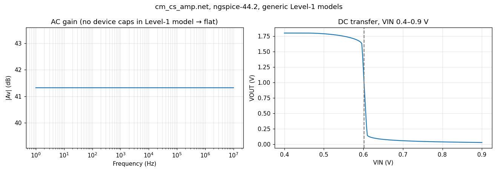

# Current-Mirror Loaded Single-Stage CMOS Amplifier

## 📌 Project Overview

Design and performance analysis of a **current-mirror loaded single-stage CMOS amplifier** using a generic **180 nm Level-1 SPICE model**.

The design targets:

- Voltage gain > **25 dB**
- Current-mirror mismatch < **5%**
- Supply voltage: **1.8 V**
- Reference current: **20 µA**
- Mid-rail output bias

This project was completed as part of my **Winter Upskilling Project**, with emphasis on CMOS analog design, MOSFET biasing, small-signal analysis, SPICE simulation, and current-mirror mismatch analysis.

## 🧩 Circuit Topology

The amplifier consists of:

- **M1:** NMOS common-source input transistor
- **M2:** Diode-connected PMOS reference transistor
- **M3:** PMOS current-mirror load
- **IREF:** 20 µA reference current source
- **VDD:** 1.8 V

The low-frequency voltage gain is approximately:

\[
A_v \approx -g_{m1}(r_{o1} \parallel r_{o3})
\]

## ⚙️ Design Parameters

| Device | Role | W/L |
|---|---|---|
| M1 | NMOS common-source | 6 µm / 1.0 µm |
| M2 | PMOS diode reference | 24 µm / 1.5 µm |
| M3 | PMOS active load | 24 µm / 1.5 µm |

### SPICE Model

**NMOS**
- VTO = 0.45 V
- KP = 270 µA/V²
- λ = 0.08 V⁻¹

**PMOS**
- VTO = −0.45 V
- KP = 70 µA/V²
- λ = 0.04 V⁻¹

## 📊 Key Results (ngspice-44.2, generic Level-1 models)

These numbers come from simulating `simulation/LTspice/cm_cs_amp.net` in **ngspice-44.2** (21 Oct 2026). They hold only for these generic Level-1 models; they are not foundry or silicon results. The logs, data and plot are in [`results/ngspice/`](results/ngspice/).

| Parameter | Simulated result |
|---|---:|
| Supply | 1.8 V |
| Reference current | 20 µA |
| Input bias | 0.602 V |
| Output bias V(vout) | 0.963 V |
| Low-frequency gain (at 10 Hz) | **41.3 dB** (116.5 V/V) |
| Output resistance 1/(g_ds1 + g_ds3) | ≈ 439 kΩ |
| Supply power (V_DD × I_DD, incl. reference branch) | ≈ 72.3 µW |
| M3 vs reference current at bias (V_OUT = 0.963 V) | +0.78 % |
| Systematic mirror error where V_OUT = 0.9 V (DC sweep) | +1.03 % |
| Gain target > 25 dB | Met in this simulation |



**Bandwidth is not characterised.** The Level-1 models define no gate or junction capacitances, and the netlist has no load capacitor, so the simulated gain stays flat at 41.3 dB up to 10 MHz. A meaningful −3 dB frequency needs capacitances in the model or an explicit C_L.

## 🔬 Current-Mirror Mismatch

1. **Systematic mismatch** (unequal V_SD plus channel-length modulation) was simulated: +1.03 % where V_OUT = 0.9 V.
2. **Random mismatch** (V_T and β variation) **has not been simulated in this repository yet.** The netlist contains no Monte Carlo analysis, so no random-mismatch figure or combined mismatch budget is claimed. Verifying the < 5 % target needs a Monte Carlo deck with stated Pelgrom coefficients, committed together with its output.

## 🧪 Simulation

The project includes an LTspice SPICE netlist containing:

- DC operating-point analysis
- DC input sweep
- AC frequency response
- Gain measurement

The netlist uses a generic Level-1 MOS model and is intended for educational/design-analysis purposes rather than foundry sign-off.

**Run in LTspice:** open `simulation/LTspice/cm_cs_amp.net` in LTspice (File → Open, file type "Netlists"). Two edits are needed first, checked with LTspice 26.1.1 in batch mode (`LTspice.exe -b`):

1. As committed, LTspice stops immediately with `More than one analysis specified.` Keep exactly one of `.op`, `.dc` or `.ac` active and comment out the others with `*`.
2. With only `.ac` active, the `.meas` line fails with `No such function defined.` because LTspice has no `vdb()` function. Use `.meas AC gain_db FIND V(vout) AT=10` instead; LTspice then reports `gain_db: V(vout)=(41.3235936703dB,180°) at 10`, matching the ngspice result. Measurements appear in the SPICE error log (View → SPICE Error Log).

The committed netlist itself is left unchanged.

**ngspice compatibility:** run as-is, ngspice-44.2 stops on `.backanno`, an LTspice-only command it reports as an unimplemented dot command. The original `.meas` line was not tested in ngspice, because the wrapper re-issues an equivalent measurement inside its `.control` block. `results/ngspice/run_ngspice.cir` runs a copy with that line (and the analysis lines, which are re-issued inside a `.control` block) removed:

```sh
cd results/ngspice
ngspice -b run_ngspice.cir > ngspice_run.log   # writes ac.txt, dc.txt
python3 plot_results.py                        # writes ngspice_results.png (needs matplotlib)
```

## 📁 Repository Structure

```
Current_Mirror_Loaded_Amplifier/
├── README.md
├── .gitignore
├── calculations/
│   └── theoretical_analysis.md
├── results/
│   ├── theoretical_vs_simulation.md
│   └── ngspice/
│       ├── run_ngspice.cir
│       ├── cm_cs_amp_ngspice.net
│       ├── ngspice_run.log
│       ├── ac.txt, dc.txt
│       ├── plot_results.py
│       └── ngspice_results.png
└── simulation/
    └── LTspice/
        └── cm_cs_amp.net
```

## 🚀 Future Work

- Add a Monte Carlo mismatch deck and commit its results.
- Add device capacitances / load capacitance and characterise bandwidth.
- Replace the Level-1 model with a foundry BSIM model.
- Perform Cadence Virtuoso schematic and layout implementation.
- Implement common-centroid layout for the current mirror.
- Perform post-layout parasitic extraction and re-simulation.
- Compare pre-layout and post-layout gain/mismatch.

## 👨‍💻 Author

**Srishanth Reddy**  
B.Tech Electronics & Communication Engineering  
Chaitanya Bharathi Institute of Technology (CBIT), Hyderabad

---

**Focus areas:** Analog IC Design • CMOS • Current Mirrors • SPICE • LTspice • VLSI • MOSFET Small-Signal Analysis
